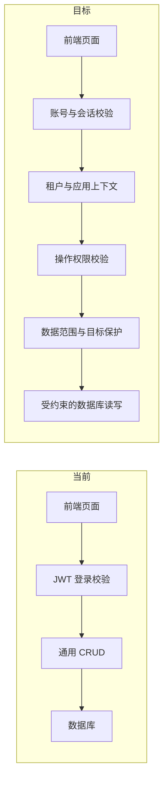

# YamAuth 用户权限与数据隔离设计方案

| 项目 | 说明 |
| --- | --- |
| 确认日期 | 2026-11-15 |
| 设计状态 | 业务边界与整体方案已确认，供项目成员讨论和实施评审 |
| 实施状态 | 尚未实施，本文描述目标行为，不代表当前系统已经具备这些能力 |
| 源码分析基线 | `bfb063158b62ce3d57b5ca44eae3339229a16a3a` |
| 分析方式 | 前后端及生成器只读源码检查，未连接真实数据库，未进行真实账号接口验收 |

## 1. 目标与已确认边界

采用“单租户账号 + 平台／租户／普通成员三层身份 + 按操作授权的多角色机制 + 与操作绑定的数据范围”，由后端统一执行，前端菜单、页面和按钮使用同一份有效授权结果。

目标是让普通用户只能看到获准的模块、执行获准的操作、访问获准的数据，并且无法通过直接请求接口、修改参数、绑定角色或修改管理员资料绕过限制。

本次设计的范围已经确认：

- 按多租户设计，租户之间默认互不可见；第一版继续使用一个物理数据库，通过明确的租户归属和后端读写约束隔离数据。
- 一个普通账号只属于一个租户，禁止自行更改租户归属。同一个人服务多个租户时，第一版使用分别授权的独立账号。
- 先覆盖当前 YamAuth 后台及其 API，保留应用维度；其他业务系统接入统一认证、鉴权的完整方案留到后续。
- 未授权的新用户仅有本人基础能力，登录成功不自动获得管理权限。
- 支持多角色，按操作授权；第一版不增加逐用户例外授权或显式拒绝规则。
- 支持仅本人、本部门、指定部门、本租户全部四种数据范围，按资源和操作配置；第一版不增加部门树及下级部门范围。
- 撤销权限、禁用账号或重置密码后，要求从下一次请求开始生效。
- 保留现有业务数据，采用可核对、可回退的增量迁移；不清空数据库，不运行不适用的旧初始化脚本。

本文中的接口名称和新增列名是实现建议，具体命名沿用项目约定；业务边界与授权语义不应在实施时未经评审而改变。最终列类型、约束及索引需结合真实数据库元数据核实。

## 2. 当前实现与改造依据

现有 .NET 8、FreeSql、React，以及用户、租户、应用、功能、角色等主要模型可以保留，不需要更换框架。已有管理页面与表结构不等于已有授权执行机制。

| 已确认的现状 | 方案中的处理 | 源码依据 |
| --- | --- | --- |
| 管理 Controller 主要只有普通 `[Authorize]`，只要求登录 | 增加操作权限校验，并检查目标对象和数据范围 | [UsersController](../src/YamAuth.Api/Controllers/V1/Auth/UsersController.cs)、[Program](../src/YamAuth.Api/Program.cs) |
| 用户通用更新 DTO 包含密码、管理员标志、启用状态和租户 | 拆分本人资料、普通资料编辑、密码重置、身份任命等入口 | [UserUpdateDto](../src/YamAuth.Dtos/Auth/UserUpdateDto.cs)、[UserService.Extensions](../src/YamAuth.Service/YamBase/Auth/UserService.Extensions.cs) |
| 菜单接口返回全部未隐藏菜单 | 根据当前用户有效权限构建菜单树 | [MenuTreeService](../src/YamAuth.Service/YamBase/Auth/MenuTreeService.cs) |
| 通用仓储按 ID 获取数据时，只检查软删除 | 统一加入租户和操作对应的数据范围 | [RepositoryBase](../src/YamAuth.Repository/Abstractions/RepositoryBase.cs) |
| 数据角色还不能表达实际数据范围 | 将范围绑定到每一项角色操作授权 | [DataRole](../src/YamAuth.Entity/YamBase/Auth/DataRole.cs) |
| JWT 缺少账号状态回查和会话撤销 | 增加服务端会话、安全版本和授权版本核对 | [AuthLoginService](../src/YamAuth.Service/Auth/Service/AuthLoginService/AuthLoginService.cs)、[Program](../src/YamAuth.Api/Program.cs) |
| CodeGen 会覆盖各层标准代码 | 同步改造生成规则，防止重新生成后恢复为无授权状态 | [生成指南](codegen.md) |

这些是分析基线中的源码结论，不能替代对实际部署版本、数据库约束及数据内容的核对。

## 3. 授权原则与总体架构

权限判断必须同时检查身份、操作、范围和目标，不能单独依赖一个角色名称。

普通业务操作的判定为：

```text
允许操作 =
    账号、会话和租户有效
    且当前应用匹配
    且拥有该操作的授权
    且目标数据属于当前租户
    且目标数据落在该操作允许的范围内
    且满足管理员保护、字段修改和关联一致性规则
```

例如，有“修改用户”权限，不代表可以修改管理员；有“修改本人项目”权限，不代表可以修改别人负责的项目；有“本租户全部数据”范围，不代表可以访问其他租户；是其他应用的管理员，也不代表是 YamAuth 后台管理员。

菜单被隐藏不代表对应接口自动安全。后端始终独立判定，前端授权结果用于展示和交互。



选用当前应用内部的集中授权服务和统一数据访问约束：

| 实现方式 | 安全与维护 | 性能、资源及运行成本 | 本项目选择 |
| --- | --- | --- | --- |
| 各 Controller、Service 分别手写判断 | 可以实现规则，但容易遗漏或出现不一致 | 不新增服务；重复查询和维护成本较难控制 | 不作为主要结构 |
| 应用内集中计算权限，各入口统一执行 | 规则集中，仍须覆盖全部入口和生成器 | 增加状态查询与有限缓存；沿用现有部署 | 采用 |
| 独立鉴权服务 | 适合多个系统共同执行统一策略 | 增加网络调用、部署、故障处理和协议维护 | 当前阶段暂不引入 |

以上成本判断来自架构分析，尚无性能实测。租户数据继续共库保存，以 `TenantId` 作为强制隔离条件。统一数据访问边界、数据库约束和跨租户测试共同保障隔离；需要独立备份、独立部署或更强物理隔离的租户，可在后续引入独立数据库。

## 4. 身份层级与管理员保护

### 4.1 身份权限矩阵

管理员身份不能通过普通角色配置获得。

| 能力 | 平台超级管理员 | 租户管理员 | 普通成员 |
| --- | --- | --- | --- |
| 管理租户 | 可以 | 不可以 | 不可以 |
| 任命、撤销租户管理员 | 可以 | 不可以 | 不可以 |
| 管理本租户普通成员 | 进入指定租户后可以 | 可以 | 仅限明确授予的普通成员管理操作及范围 |
| 重置其他管理员密码、停用其他管理员 | 通过专用管理入口 | 不可以 | 不可以 |
| 配置本租户业务角色、分配角色 | 进入指定租户后可以 | 可以 | 不通过普通业务角色开放授权管理能力 |
| 处理本租户全部业务数据 | 进入指定租户后可以 | 可以 | 按具体角色授权 |
| 修改本人基础资料、修改本人密码 | 可以 | 可以 | 可以 |
| 修改后台自身的权限定义、内置菜单 | 可以 | 不可以 | 不可以 |

建议保留 `User.IsAdmin`，将其含义固定为平台超级管理员，不再同时表达租户管理员。

租户管理员使用独立、受保护的内置角色标识。不能只根据可编辑的角色名称、`RoleCode` 或普通 `IsSystem` 字段判断身份；任命、撤销必须经过平台专用服务。

### 4.2 目标账号保护

管理员保护规则在后端业务层统一执行：

- 普通成员即使获得用户编辑、密码重置权限，也只能处理其范围内的普通账号。
- 租户管理员不能修改其他租户管理员的资料、重置其密码、停用或删除其账号，也不能通过用户更新、角色关联或应用成员接口修改同级管理员身份。
- 自助接口只操作当前账号，不能传入其他用户 ID。
- 普通更新接口不接受管理员标志、租户归属、密码等受保护字段。
- 停用、删除、撤销管理员前，在事务中保证平台或租户仍有至少一个有效管理员；并发操作也不能突破这个规则。

### 4.3 平台进入租户的管理上下文

平台管理员默认处于平台管理范围。处理租户业务前，建立绑定当前账号、会话和目标租户的管理上下文，记录进入、退出及期间操作。

后端验证这个上下文，不能仅凭前端传入 `TenantId` 就放行。平台管理员不需要冒用租户用户身份，业务列表也不自动混合显示所有租户的数据。

上下文应绑定具体请求，避免同一管理员在两个页面分别处理租户 A、B 时互相串数据。这是应用层的访问约束，不能替代对数据库运维人员的管理。

## 5. 应用边界与权限目录

### 5.1 内置后台与其他应用

YamAuth 后台自身是一个固定的内置应用，其他应用的权限不能影响它。

| 应用类型 | 归属与规则 |
| --- | --- |
| YamAuth 内置后台 | 平台维护的固定应用；各租户在该应用下拥有自己的角色和成员授权 |
| 租户管理的其他应用 | 归属一个租户；其功能、角色、成员配置与后台权限隔离 |

不能把 `TenantId = null` 普遍解释为“所有人共享”。平台内置应用必须有明确、受保护的类型和稳定标识；其他空租户记录属于待核对数据。

`AppsUser.IsAdmin` 只描述对应外部应用的配置，不参与 YamAuth 后台管理员判定。内置后台的管理员身份不能通过应用用户通用接口授予。第一版不增加第四层应用管理员身份，其他系统真正接入鉴权留到后续。

普通账号登录后台的资格由账号、租户状态决定；具体管理能力来自后台应用下的授权，不再另引入一套可能冲突的应用管理员开关。

### 5.2 权限定义的维护边界

YamAuth 内置后台的权限码、接口对应关系、菜单定义及内置管理员角色由平台维护。租户管理员只能从本租户允许使用的权限中创建业务角色、配置范围和分配成员。

租户管理员不能通过新建权限码绕过后端规则，也不能修改内置管理员角色。其他应用的配置继续按所属租户管理，但不影响后台自身的授权。

现有菜单中的 `AllowAny` 不能用来开放匿名管理接口。后台公开入口由代码明确列举，例如登录；普通业务页面仍要求认证和授权。

## 6. 操作权限与角色模型

### 6.1 权限码

权限码表达具体操作，建议采用稳定的“资源 + 操作”形式：

```text
unit.employees.read
unit.employees.create
unit.employees.update
unit.employees.delete

bzss.projects.read
bzss.projects.create
bzss.projects.update
bzss.projects.delete
bzss.projects.transfer

auth.users.read
auth.users.create
auth.users.update
auth.users.disable
auth.users.reset_password
```

平台管理、管理员任命和授权管理属于受保护的管理能力，不能直接放进普通租户业务角色的可选清单。

### 6.2 现有模型的适配

| 现有模型 | 目标职责 |
| --- | --- |
| `CrudInfo` | 明确表示目录或操作权限节点，操作节点具有稳定权限码 |
| `CrudItem` | 记录权限与接口的对应关系，便于核对、展示和覆盖检查 |
| `CrudMenu` | 关联页面所需权限，用于菜单展示 |
| `CrudRole` | 保存角色定义及所属租户、应用 |
| `CrudRoleCrud` | 保存角色拥有的操作，以及该操作的数据范围 |
| `CrudRoleUser` | 保存用户拥有的角色 |

接口实际要求的权限码由代码明确声明。后台内置接口不能因为数据库里的 `ApiPath` 被修改，就改变鉴权要求。数据库中的接口配置与代码清单应互相校验，不能由可编辑的字符串匹配结果决定是否放行。

当前 `CrudType` 没有明确的已实现枚举语义，实施时应新增或明确专用字段，不擅自给现有数字赋予新含义。

### 6.3 树形结构与继承

角色和功能树只用于分类，不自动继承权限。批量勾选父目录可以选中当前子项，但未来新增权限不会自动加入已有业务角色。

菜单目录因有可见子菜单而显示，不代表获得其他子菜单的权限。角色及其关联必须满足所属租户、应用的一致性，不能通过跨范围的父子关系传播权限。

## 7. 数据范围与多角色计算

### 7.1 标准范围

数据范围与操作绑定，多角色只合并同一操作的范围。

| 范围 | 含义 |
| --- | --- |
| `Self` | 当前用户关联或负责的数据 |
| `Department` | 当前用户所属部门的数据 |
| `CustomDepartments` | 明确指定的本租户部门数据 |
| `TenantAll` | 当前租户全部数据 |

不是每种范围都适用于每个资源、每个操作。权限配置界面只展示该操作支持的范围；不适用的组合必须拒绝保存。管理配置类资源按租户、应用和管理资格判断，不套用“谁创建的就是谁的数据”。

当前部门没有上下级字段，第一版不增加部门树，也不自动推导下级部门范围。

### 7.2 合并规则

```text
某操作的有效范围 =
    所有授予该操作的角色范围之并集

最终数据条件 =
    当前租户条件
    且该操作的有效范围
```

例如，一个用户同时拥有以下角色：

| 角色 | 授权 |
| --- | --- |
| 全员查看员 | 员工查看：本租户全部 |
| 个人维护员 | 员工修改：仅本人 |
| 一部编辑员 | 员工修改：指定部门“一部” |

该用户可以查看全租户员工，修改范围仅为本人和一部员工。查看范围不会被借用来扩大修改范围。

缺少授权就是不允许。数据范围缺失或配置非法时，也不能默认回退成“全部”。

### 7.3 现有数据角色的处理

第一版建议直接将范围保存在角色操作授权中，不另做一条独立的“用户 → 数据角色 → 全局范围”执行链。

既有 `DataRole`、`DataRoleUser` 数据保留并核对迁移；未完成明确映射的记录不参与后台授权，避免两套规则同时生效。内置后台的授权界面收敛到角色操作范围配置，不再向使用者提供两套可能相互冲突的授权入口。

## 8. 数据归属与写入规则

### 8.1 按资源定义归属

数据归属按资源定义，审计创建人不承担业务所有权。

| 资源 | 租户归属 | 本人范围 | 部门范围 |
| --- | --- | --- | --- |
| 用户 | `User.TenantId` | 当前用户 ID | 通过有效员工关系确定部门 |
| 员工 | 新增明确的 `Employee.TenantId` | `Employee.UserId` | `Employee.DepartmentId` |
| 公司 | `Company.TenantId` | 新增 `OwnerUserId` | 新增 `OwnerDepartmentId` |
| 项目 | `Project.TenantId` | 新增 `OwnerUserId` | 新增 `OwnerDepartmentId` |
| 角色、应用配置等 | 明确的租户及应用关系 | 按管理权限处理 | 不机械套用部门范围 |

分析基线中的员工缺少 `TenantId`，公司、项目缺少负责人和归属部门字段，参见 [Employee](../src/YamAuth.Entity/YamBase/Unit/Employee.cs)、[Company](../src/YamAuth.Entity/YamBzss/Bzss/Company.cs)、[Project](../src/YamAuth.Entity/YamBzss/Bzss/Project.cs)。

### 8.2 归属校验

- 一个普通账号在本租户最多绑定一条有效员工记录、一个当前部门。
- 未绑定部门的账号不会获得本部门范围，但可以通过本人或其他明确授权访问数据。
- 员工、部门、用户及负责人之间必须属于同一个租户。
- 创建公司、项目时，由服务端确定租户，并校验负责人、部门是否属于允许的创建范围。
- 修改普通业务内容与转移负责人、归属部门分开；转移需要独立权限。
- 员工调岗不会自动转移其负责的全部公司、项目。业务记录的部门归属通过明确操作变更。
- 普通编辑不提供跨租户迁移数据的能力。

归属转移必须检查原记录的操作权限、新归属是否合法，并在同一事务中完成。不能只检查旧记录后，允许请求把它改到任意部门或用户名下。

管理员代替员工录入数据时，数据仍可正确归属于员工。历史上无法确定负责人或部门的数据，不通过猜测归属向普通用户开放。

## 9. 数据库调整

### 9.1 逻辑结构

以复用现有模型为主，新增必要的授权、会话和审计结构。以下列名为实现建议，具体类型及约束需核对真实数据库后确定。

| 表或模型 | 主要调整 |
| --- | --- |
| `User` | 明确平台管理员与租户归属约束；新增 `SecurityVersion`、`MustChangePassword` |
| `Tenant` | 新增租户授权版本；启用状态参与每次请求校验 |
| `AppsInfo` | 明确内置后台／租户应用类型；内置应用保存权限目录版本 |
| `CrudInfo` | 明确权限节点类型、资源、操作及可支持的数据范围 |
| `CrudRole` | 明确所属租户、应用及受保护角色类型 |
| `CrudRoleCrud` | 增加该操作的 `ScopeType` |
| 角色授权部门关联表 | 保存某条操作授权允许访问的指定部门 |
| `CrudRoleUser` | 补齐可验证的租户、应用一致性及有效关联唯一性 |
| `Employee` | 新增明确租户归属，约束有效用户绑定唯一性 |
| `Company`、`Project` | 新增负责人、归属部门；对并发修改增加版本控制 |
| 登录会话表 | 保存用户、到期时间、撤销状态等 |
| 平台租户管理上下文表 | 绑定平台账号、会话、目标租户及有效状态 |
| 审计事件表 | 保存操作主体、目标、范围、结果和必要变更摘要 |

### 9.2 约束与索引

数据库和服务层共同保证：

- 租户账号必须具有有效租户，平台账号通过明确身份区分。
- 角色不能绑定其他租户的用户，也不能授予其他应用的权限。
- 指定部门必须属于该角色所在租户。
- 用户角色、角色权限等有效关联不能重复。
- 业务表具有适合租户条件、归属条件和分页排序的索引。
- 软删除不能被用来绕过关联校验或产生重复有效绑定。

用户名与登录邮箱需要规范化并检查歧义，包括“某人的用户名恰好等于另一人的登录邮箱”。建议用统一的登录标识关系保证一个标识只指向一个账号；历史冲突先列入迁移清单，不继续依赖用户名优先的查询顺序猜测身份。

## 10. 后端授权执行

### 10.1 组件职责

后端分层执行授权，避免一个遗漏的 Controller 或仓储方法成为旁路。

| 组件职责 | 执行内容 |
| --- | --- |
| 当前访问上下文 | 确定用户、会话、身份、租户、应用及平台管理上下文 |
| 操作授权服务 | 计算当前操作是否允许、授予来源和有效范围 |
| 数据范围构建器 | 将已验证的范围转换为数据库查询条件 |
| 管理保护服务 | 校验管理员目标、角色授予边界、受保护字段和关联一致性 |

ASP.NET Core 的策略授权适合执行操作权限检查；涉及具体对象时，还需要基于资源的授权判断，单独一个 `[Authorize]` 不能覆盖对象归属规则。参见 [ASP.NET Core 资源授权文档](https://learn.microsoft.com/en-us/aspnet/core/security/authorization/resource-based?view=aspnetcore-8.0)。

### 10.2 执行边界

1. 每个业务接口声明权限码；本人基础操作使用明确的自助策略。
2. 未标注权限策略的业务接口不能默认为登录后可用。
3. 启动检查和自动化测试扫描接口，发现遗漏策略或错误匿名开放就失败。
4. 列表、总数、详情和关联查询使用相同的数据范围构建规则。
5. Service 对管理员目标、归属变更、授予资格进行业务校验。
6. 最终更新、删除语句仍带租户、数据范围和并发版本条件。

修改操作的约束应相当于以下示意条件：

```sql
WHERE Id = @id
  AND TenantId = @currentTenantId
  AND IsDeleted = 0
  AND <当前操作允许的数据范围>
  AND RowVersion = @expectedVersion
```

上述内容是设计示意，不是可执行迁移 SQL。范围表达式只能由后端受控代码生成，不能接受客户端传入 SQL 或任意条件字符串。

FreeSql 的过滤能力可以辅助复用条件，但不能仅依靠一个全局过滤器就认定隔离完成。原生 SQL、关联查询、更新、删除、树形事务等路径都要核对；不能在单例 `IFreeSql` 上按请求反复修改共享租户状态。

默认认证策略只是底线，不能替代具体操作授权。ASP.NET Core 的 fallback policy 不会自动叠加到已经声明了其他授权策略的接口上。参见 [ASP.NET Core 策略文档](https://github.com/dotnet/aspnetcore.docs/blob/main/aspnetcore/security/authorization/policies.md)。

## 11. 账号流程与接口拆分

### 11.1 账号开通及自助维护

- 平台管理员创建租户及首个租户管理员；租户管理员创建普通成员，第一版不开放公开注册。
- 用户名保持全平台唯一，沿用当前不需要选择租户的登录入口。
- 新建账号和管理员重置密码后，用户必须先修改初始密码，才能进入获准的业务页面。
- 本人可以修改昵称、头像、联系电话；用户名、租户、管理员身份、启用状态不能通过本人资料接口修改。
- 邮箱目前可用于登录，修改登录邮箱需要独立入口和身份校验，不能混在普通资料保存中直接替换。
- 本人修改密码须验证旧密码；修改或重置密码后，此前的所有登录会话失效，重新登录。

### 11.2 接口建议

敏感字段不再进入通用用户更新。具体接口命名沿用现有项目约定。

| 用途 | 建议入口或处理方式 |
| --- | --- |
| 获取本人资料与当前身份 | `GET /api/v1/auth/me` |
| 获取当前有效权限、菜单及授权版本 | `GET /api/v1/auth/access` |
| 修改本人基础资料 | 独立的 `/auth/me/profile`，字段白名单 |
| 修改本人密码 | 保留现有 `change-password` 入口，补会话失效 |
| 修改登录邮箱 | 独立入口，验证当前凭据及标识唯一性 |
| 管理普通用户资料 | 保留 `/auth/users/{id}`，使用收窄后的 DTO |
| 重置密码 | `/auth/users/{id}/reset-password` |
| 停用、启用用户 | 独立状态操作 |
| 任命、撤销租户管理员 | 平台专用入口 |
| 配置角色权限及范围 | 事务性保存角色授权配置 |
| 给成员分配角色 | 专用角色分配入口，禁止跨租户、跨应用 |
| 转移项目、公司归属 | 独立归属转移入口 |
| 进入、退出租户管理上下文 | 平台专用入口 |
| 退出登录 | 撤销当前服务端会话 |

用户资料编辑 DTO 不含 `Password`、`IsAdmin`、`TenantId`。停用、重置密码、管理员任命不能通过 DTO 映射顺带完成。

### 11.3 关联选择器

关联选择器提供独立的最小候选接口。例如，拥有员工编辑权限的人可以查询该操作允许选择的用户 ID、显示名，不必因此获得用户管理列表、手机号、邮箱等完整信息。

候选项回显和实际提交都要校验。知道某条记录的 ID，不构成读取或关联它的资格。

### 11.4 响应语义

| HTTP 状态 | 含义 |
| --- | --- |
| `401` | 会话失效、凭据无效或账号已经不能继续使用 |
| `403` | 已认证，但缺少该操作权限 |
| `404` | 目标不存在或不在允许访问的对象范围内 |
| `409` | 并发修改、重复绑定或违反必须保留管理员等状态约束 |

## 12. 会话、即时撤权与缓存

### 12.1 每次请求的检查

“下一次请求生效”通过服务端状态核对实现，缓存不能延长旧权限。

登录令牌主要携带用户、会话标识和安全版本，不把一整份可长期使用的权限清单固化进 JWT。每次请求按顺序检查：

1. JWT 签名、有效期、发行者和受众。
2. 服务端会话是否有效。
3. 用户是否启用、是否删除、安全版本是否匹配。
4. 租户是否启用。
5. 当前授权版本与权限目录版本。
6. 按当前版本取得有效权限和数据范围。

### 12.2 状态变更的生效方式

| 事件 | 生效方式 |
| --- | --- |
| 修改或重置密码 | 更新安全版本，旧会话全部失效 |
| 停用、删除用户 | 下一次请求读取到无效状态后拒绝 |
| 停用租户 | 该租户账号下一次请求不能继续使用后台 |
| 修改角色权限、成员角色或部门归属 | 同事务更新对应授权版本 |
| 退出登录 | 撤销当前会话 |
| 退出平台租户管理上下文 | 该上下文随即不可再使用 |

缓存只保存“某版本对应的权限计算结果”。每次请求仍向一致的权威数据源核对版本，不使用带过期延迟的本地账号状态缓存满足即时撤权要求。

缓存重建期间若授权版本发生变化，应重新读取，不能把旧权限内容标记为新版本。多实例部署也要遵守同样规则。

“下一次请求”以撤权事务提交后开始鉴权的新请求为边界。已经执行完成的操作不会被追溯撤销；敏感写操作在提交前增加必要的状态核对和并发保护。

首次登录或管理员重置密码后，`MustChangePassword` 状态仅允许改密、必要的本人状态查询和退出，不开放业务接口。

## 13. 前端接入

前端使用有效授权驱动展示，后端保持最终判定职责。现有 `AppContext`、`ResourceDef` 和 `ResourceCrudPage` 可以集中接入：

- 登录后先取得本人访问上下文及有效授权。
- 权限加载完成前不发起管理列表、角色树和关联候选请求。
- 菜单只显示拥有页面访问权限的项；目录仅在存在可见子项时显示。
- 用户手动输入路由时，路由守卫检查权限。
- 新增、编辑、删除、密码重置、授权等按钮分别检查对应操作。
- 列表按需要返回当前记录可执行的动作，避免有编辑权限却对所有行都显示编辑按钮。
- 收到 `403` 时更新权限状态并提示，不能把所有 `403` 都当成账号退出。
- 收到会话失效响应时，清理会话及页面状态。
- 租户管理上下文发生变化时，清理列表、表单、选中项、候选项及请求缓存，丢弃旧上下文回包。

现有跨标签页会话协调机制继续复用，并把访问上下文和权限版本纳入失效边界。缓存键至少区分用户、租户、应用和上下文，不能只按接口 URL 缓存。

内置后台的“数据角色”授权入口收敛到角色操作范围配置，避免出现两套看起来都能决定权限的界面。

## 14. 审计

审计跟随授权变更和业务操作落地，默认保留 180 天并允许配置。审计事件至少包括：

```text
操作者、会话、实际租户、应用、管理上下文、
动作、目标类型与 ID、结果、时间、请求关联 ID、
允许记录的变更摘要
```

覆盖以下事件：

- 用户创建、停用、删除，密码重置及管理员身份变更。
- 角色权限、数据范围和用户角色分配的变更。
- 平台管理员进入、退出指定租户，以及在该上下文内执行的业务操作。
- 业务数据的新增、修改、删除和归属转移。
- 被拒绝的敏感访问及跨租户访问尝试。

密码、令牌、应用密钥不进入日志；审计摘要按字段白名单生成，不能直接序列化完整请求。

权限变更与其审计记录应在同一事务中可靠保存。当前 Base、Bzss 使用不同 FreeSql 实例，不能假定它们自动共享事务；跨写入边界的业务审计可在业务事务中先写本地事件记录，再可靠汇入统一审计，避免业务成功而审计丢失。

租户管理员只能查询本租户日志，平台管理员按权限查询平台审计。普通管理 API 不提供审计修改、删除能力，保留期清理由受控后台任务执行。

## 15. CodeGen 与公共扩展

生成器和扩展代码必须一起改造，否则权限会在下一次生成时丢失。

当前 [ControllerGenerator](../src/YamAuth.CodeGen/Generators/ControllerGenerator.cs) 固定生成普通 `[Authorize]`；[DtoColumnRules](../src/YamAuth.CodeGen/Schema/DtoColumnRules.cs) 也没有将租户、管理员等字段普遍视为受保护写入字段。

建议增加统一的资源安全规则清单，明确每种资源的：

- 所属范围：平台、租户，或通过应用、角色关联推导。
- 操作权限码。
- 支持的数据范围。
- 服务端维护字段与专用操作字段。
- 可使用的关联候选及一致性规则。

生成器根据清单生成接口权限声明、受约束的数据入口和 DTO。未登记安全规则的资源，不能默认生成可公开给所有登录用户使用的 CRUD。

管理员保护、会话、授权计算等逻辑保留在明确的手写扩展和公共服务中。生成行为验证在独立临时输出目录完成，不对现有库运行全量生成来试验。

契约 DTO 与分页类型继续放在 `src/YamAuth.Dtos/`，不恢复旧路径。执行生成前遵守 [生成指南](codegen.md)，不能把 CodeGen 当作只读检查或单表增量操作。

## 16. 实施、迁移与切换

### 16.1 实施阶段

按五个阶段推进，正式启用时必须形成完整闭环。

| 阶段 | 主要工作 | 阶段完成条件 |
| --- | --- | --- |
| A：清点与模型准备 | 核对真实表结构、索引、数据归属、账号与角色；准备增量迁移 | 每类记录有明确处理规则，无法归属的数据形成清单 |
| B：后端统一边界 | 访问上下文、会话、操作授权、范围构建、目标保护、生成器规则 | 直接调用 API 也无法绕过权限和租户约束 |
| C：资源与前端接入 | 覆盖现有管理资源、选择器、菜单、路由、按钮和账号专用操作 | 普通用户完整流程可用，前端与后端规则一致 |
| D：迁移演练与验收 | 在隔离环境验证数据映射、并发、撤权和性能 | 验收用例通过，回退和维护流程演练完成 |
| E：维护窗口切换 | 备份、迁移、核对首批管理员与授权、废止旧会话、开放访问 | 新旧数据核对通过，真实账号验收通过 |

### 16.2 历史数据处理

迁移前备份，保留现有业务数据。重点核对：

- `TenantId` 为空但并非平台数据的记录。
- 用户、员工、部门之间的租户冲突。
- 跨租户、跨应用的角色关联。
- 重复员工绑定和重复授权。
- 无法对应具体操作的历史功能授权。
- 无法确定负责人、部门的公司和项目。
- 用户名、邮箱登录标识冲突。

无法确认归属的数据先隔离，不自动分配给执行迁移的人，也不当成公共数据开放。未确认归属的数据不向普通用户开放。

现有管理员标记和授权关系核对后再迁移。由于旧系统没有可靠的授权执行边界，不能仅凭历史 `IsAdmin = true` 就认定该账号应获得新系统的最高权限。

### 16.3 正式切换与回退

完成数据归属和首批授权配置后，在维护窗口切换，旧登录会话全部失效。需要迁移的记录数量和维护窗口时长，在实施时只读检查真实数据库后确定，不根据源码猜测生产数据情况。

部署失败时进入维护状态或回退到经过验证的安全版本。回滚方案不能是重新开放“登录即拥有全部权限”，也不能通过关闭隔离和授权恢复业务。

不运行旧 `scripts/init-db.ps1`，不以清空数据库代替迁移；相关限制见 [项目 README](../README.md)。

## 17. 验证与验收

### 17.1 权限与隔离用例

验收以真实越权场景为主，构建通过只是其中一项检查。建议新增后端集成测试，并至少覆盖：

| 场景 | 必须得到的结果 |
| --- | --- |
| 未授权普通用户登录 | 仅能使用本人基础能力，不显示管理菜单 |
| 普通用户直接请求用户管理 API | 无权限时拒绝 |
| 修改请求中的 `IsAdmin`、`TenantId`、`Password` | 通用接口不能改变这些字段 |
| 普通用户修改或重置管理员账号 | 拒绝，目标账号不变 |
| 租户 A 请求租户 B 的详情、更新、删除 | 无数据泄露、无写入 |
| 角色绑定其他租户用户或其他应用权限 | 拒绝 |
| 全租户查看角色与本人修改角色叠加 | 仍只能修改本人范围 |
| 调用全量树、总数、候选项和名称回显接口 | 仍受相应边界约束 |
| 无部门用户获得本部门范围 | 不扩大为全租户 |
| 撤销权限后使用旧页面、旧令牌请求 | 撤权提交后的下一次请求即拒绝 |
| 密码重置、账号或租户停用 | 旧会话不能继续操作 |
| 两个管理员并发撤销最后的管理员身份 | 至少保留一个有效管理员 |
| 平台管理员在不同租户上下文并发请求 | 数据与审计归属不串用 |
| 归属转移与数据编辑并发 | 不发生检查后越权或覆盖 |
| 新增接口漏写权限、重新生成代码 | 覆盖检查失败，不能静默进入可用状态 |

### 17.2 性能与资源验证

验证授权查询次数、典型列表和大租户列表的 P95 延迟、缓存占用、并发改权以及审计写入成本。

当前没有性能实测，不承诺具体性能数字。索引和缓存优化建立在测量结果上，并保持即时撤权语义。

### 17.3 项目检查

后续实施按 [项目工作指引](../AGENTS.md) 执行检查。后端在仓库根目录运行：

```sh
dotnet build src/YamAuth.sln -c Release
```

前端在 `web/YamAuth.Web` 目录运行：

```sh
npm run check
```

当前测试与工具限制见 [README 的验证与旧工具说明](../README.md#验证与旧工具)。静态检查与离线测试通过，不能替代真实数据库、接口和页面验收。

## 18. 评审与实施前核实事项

本方案的业务边界和整体设计已确认。团队评审重点是检查实现是否能完整保持这些规则，并将工作拆分为可验收的实施任务。

实施前仍需以实际环境核实：

- 真实数据库的表结构、约束、索引及历史数据规模。
- 需要隔离或人工确认归属的数据清单，以及初始管理员和角色映射。
- 实际部署版本、实例数量、数据源一致性与事务边界。
- 最终迁移 SQL、执行顺序、维护窗口和回退操作。
- 授权检查、缓存、数据库查询和审计写入的实际性能。

这些事项是实施验证工作，不代表可以静默更改已确认的授权边界。若评审发现需要调整账号归属、管理员能力、数据范围或迁移原则，应明确记录变更并重新确认。

本次仅形成并保存设计文档，没有修改业务代码、执行数据库迁移或运行验收测试。文档中的目标机制不能视为已经生效的安全措施。
